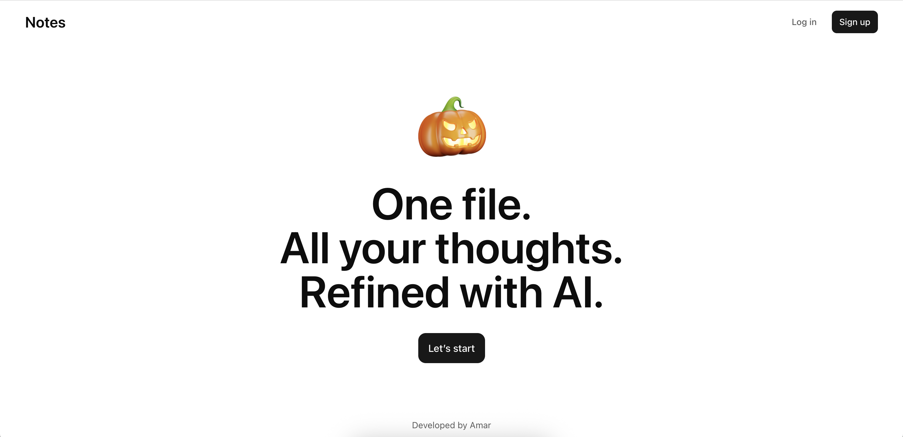
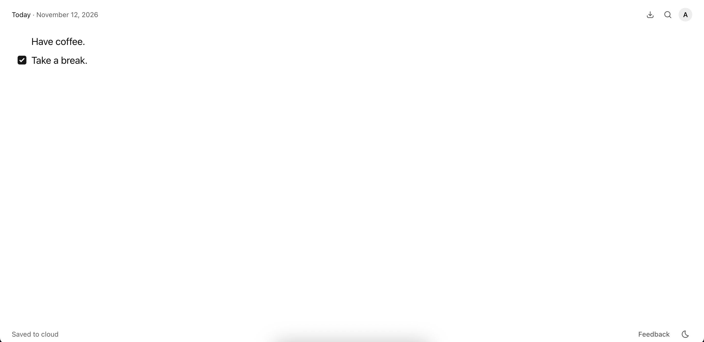
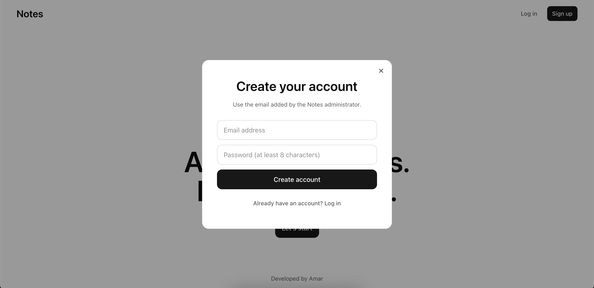

<div align="center">

# Notes

### One file. All your thoughts. Refined with AI.

A quiet, private space to write, organize, and improve your thoughts.

[Live app](https://notes.ideatinglabs.com) · [Run locally](#run-locally)

</div>



## Simple by design

- **Just write** — a focused, borderless editor with automatic saving
- **Refine with AI** — press Enter to clean up a thought without changing its meaning
- **Stay organized** — daily notes, search, tasks, timestamps, and inline timers
- **Use your voice** — optional speech-to-text with AI refinement
- **Keep it yours** — private accounts, isolated cloud storage, and local drafts
- **Take it with you** — export notes as Markdown, PDF, or Word

<table>
  <tr>
    <td width="62%"></td>
    <td width="38%"></td>
  </tr>
</table>

## Built with

React · TypeScript · TipTap · Tailwind CSS · Cloudflare Workers + D1 · Supabase · OpenAI

## Run locally

```bash
git clone <your-repository-url>
cd notes
npm install
cp .env.example .env.local
npm run dev
```

Add your Supabase public credentials and server-side OpenAI key to `.env.local`:

```env
VITE_SUPABASE_URL=
VITE_SUPABASE_PUBLISHABLE_KEY=
OPENAI_API_KEY=
```

Then open [localhost:5173](http://localhost:5173).

## Check the project

```bash
npm run check
```

## Deploy

```bash
npm run deploy
```

The app ships as a Cloudflare Worker with static assets and D1-backed storage. Production also requires the Supabase variables at build time and `OPENAI_API_KEY` as a Worker secret.

---

<div align="center">
  Built by Amar.
</div>
